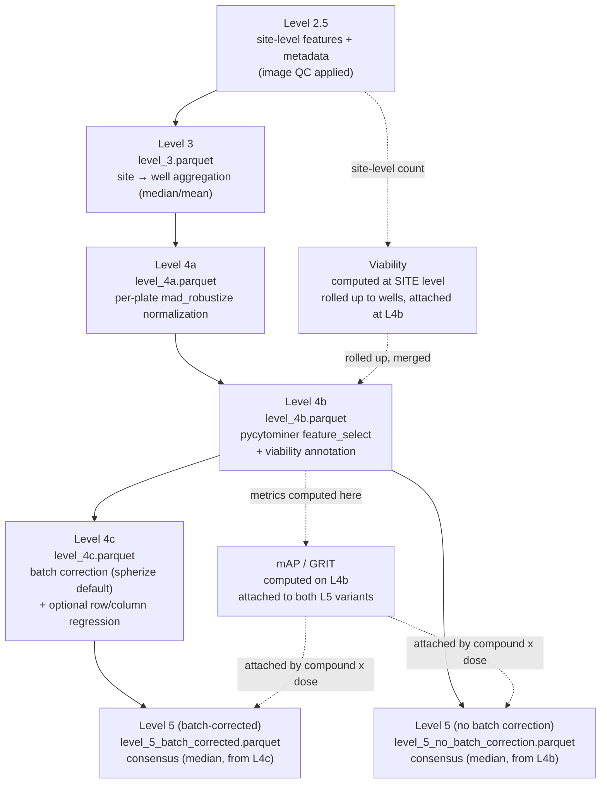

# Profile levels

Modeled on the level scheme in
[lincs-cell-painting/profiles/README.md](https://github.com/broadinstitute/lincs-cell-painting/blob/master/profiles/README.md):
one file per level, each level built from the previous one by a single,
named operation. See `NORMALIZATION.md` for the exact normalization spec and
`CLAUDE.md` for module-level architecture.

## Level 2.5 — site-level input

CellProfiler compartment merge (nuclei/cells/cytoplasm) + image-level QC
(blur/focus outliers, low nuclei-count sites, stricter DMSO-site QC). One row
per imaging site. Not saved as a pipeline output parquet (it is the pipeline's
input file); QC accounting is written to `_image_qc/`.

## Level 3 — `level_3.parquet`

**Operation:** `normalization.aggregate_sites_to_wells()` — per-site cell-count
filtering, then `pycytominer.aggregate()` (median or mean, per
`aggregation.operation`) grouped by well identity (plate + well) plus any
metadata column that's constant within a well. One row per well.

## Level 4a — `level_4a.parquet`

**Operation:** `normalization.normalize_per_plate()` — drop globally-invariant
features (MAD on raw DMSO ≤ threshold), then `pycytominer.normalize(method=
"mad_robustize")` per plate against that plate's own DMSO wells, then
inf/NaN cleanup and clipping. See `NORMALIZATION.md` for the full spec,
including the DMSO-centering validation run at the end of this step.

## Level 4b — `level_4b.parquet`

**Operation:** `normalization.feature_select()` —
`pycytominer.feature_select()` with `variance_threshold, drop_na_columns,
correlation_threshold, blocklist, drop_outliers`. Well-level viability
(computed at site level, rolled up) is merged on afterward as
`Metadata_Viability_*` columns. **mAP and GRIT are computed on this level**
(pre-batch-correction, so they reflect the raw replicate signal) and attached
to both Level 5 variants later.

## Level 4c — `level_4c.parquet`

**Operation:** `batch_correction.apply_batch_correction()`, dispatching on
`batch_correction.method`:
- `"spherize"` (default) — pycytominer ZCA whitening fit on the DMSO
  reference.
- `"combat"` — scanpy ComBat, plate as batch variable.
- `"harmony"` — harmonypy soft-k-means integration, plate as batch variable.

All three fall back to unmodified Level 4b data (with a warning) on failure.
Two further steps, **opt-in only, off by default**, run after whichever
method above: `batch_effect_fix` (least-squares row/column positional
removal) and `regress_out_column` (control-based within-plate column
de-trend).

## Level 5 — two variants, both consensus via `pycytominer.consensus()`

**Operation:** `consensus.compute_consensus()`, `operation="median"`
(pycytominer's own default), grouped by compound × concentration. Produced
twice, from two different inputs, so batch correction's effect is directly
auditable:

- `level_5_batch_corrected.parquet` — consensus of **Level 4c**.
- `level_5_no_batch_correction.parquet` — consensus of **Level 4b**.

When `batch_correction.run: false`, Level 4c equals Level 4b and the two
files are identical by construction. Both variants get mAP/GRIT and
viability merged on afterward, by compound × dose.
